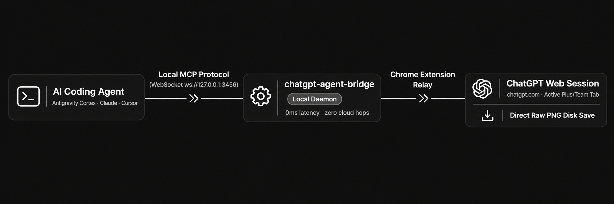

# ChatGPT Agent Bridge

[](https://m8ven.ai/mcp/nasratulnayem-chatgpt-agent-bridge-11t9l3?s=readme)

> Connect your local AI coding agents directly to your open ChatGPT Web session. No OpenAI API keys, no per-token charges, and no manual copy-pasting.

Developed by [Nasratul Nayem](https://nasratulnayem.github.io) &bull; [Read the Story & Documentation](https://nasratulnayem.github.io/tools/chatgpt-agent-bridge/) &bull; [Instagram @codex.nayem](https://www.instagram.com/codex.nayem/)

---



---

## The Real Problem Behind This Tool

I already pay **$20 a month for ChatGPT Plus**. Whenever an autonomous coding agent needed to test prompts or generate a 16-frame video storyboard, I had two frustrating options:

1. **Pay separate OpenAI API invoices** per prompt token and image generation on top of my active web subscription.
2. **Endure manual copy-paste friction:** Open ChatGPT in Chrome, enter the prompt, wait, right-click to download, rename the file, drag it into my workspace, notice a character continuity mismatch, and repeat the entire loop 16 times.

Why pay per-token API invoices when an active ChatGPT web subscription is already running in the browser?

**ChatGPT Agent Bridge** removes the friction. Local AI agents (Antigravity Cortex, Claude Desktop, Cursor) dispatch prompts directly to your active ChatGPT Web tab, evaluate outputs, maintain storyboard continuity, and download full-resolution raw PNGs straight to disk.

---

## Quickstart

### 1. Run the MCP Bridge Server
Execute directly with `npx` (zero build steps required):
```bash
npx @codex.nayem/chatgpt-agent-bridge
```
Or install globally:
```bash
npm install -g @codex.nayem/chatgpt-agent-bridge
chatgpt-agent-bridge
```

### 2. Add to Agent MCP Config
Add this block to your `claude_desktop_config.json` or `antigravity.json`:

```json
{
  "mcpServers": {
    "chatgpt-bridge": {
      "command": "npx",
      "args": ["-y", "@codex.nayem/chatgpt-agent-bridge"]
    }
  }
}
```

### 3. Install Companion Chrome Extension
1. Open Google Chrome and navigate to `chrome://extensions/`
2. Enable **Developer mode** in the top right.
3. Click **Load unpacked** and select the extension directory (or install from Chrome Web Store).
4. Open `chatgpt.com` in your browser.
5. The extension status indicates connection is live. Your local agent can now dispatch prompts directly.

---

## Core Capabilities

- **Zero API Invoices:** Uses your existing personal ChatGPT Plus or Team web plan.
- **Autonomous Feedback Loops:** The agent observes generated frames, verifies character continuity, and issues targeted prompt adjustments automatically.
- **Direct High-Res PNG Capture:** Traps uncompressed full-resolution assets directly into your workspace.
- **Local Isolation:** Runs strictly on `127.0.0.1:3456`. Zero external servers or tracking relays.

---

## Architecture Flow

```
[ AI Coding Agent: Antigravity Cortex / Claude / Cursor ]
                         │
             (Model Context Protocol)
                         │
             [ Local MCP Node.js Daemon ]
                         │
             (Local WebSocket: Port 3456)
                         │
             [ Chrome Companion Extension ]
                         │
            (DOM Bridge & Content Script)
                         │
                 [ chatgpt.com Tab ]
```

---

## License

MIT License — 100% Free & Open-Source. Built by [Nasratul Nayem](https://nasratulnayem.github.io).
